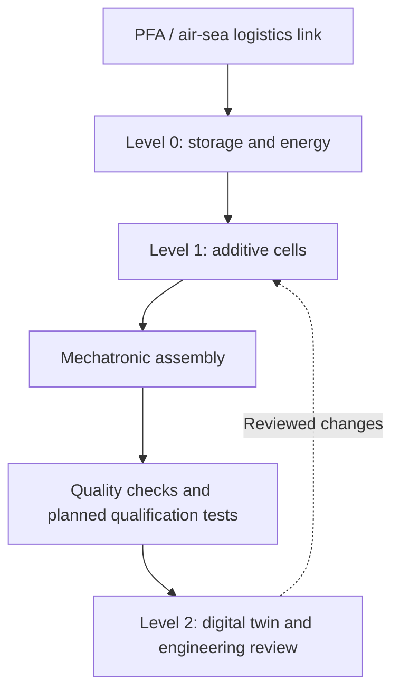

# Floating microfactory: modular architecture and digital twin

**Revision:** 12 October 2026  
**Status:** translated supplemental concept; engineering verification pending.  
**Source:** [1 Arquitectura Modular.txt](https://github.com/robotics-intelligent-systems/jfxosms/blob/e43b88dfdbf41a2a96ccd90127c3280bd8bb4152/docs/1%20Arquitectura%20Modular.txt)  
**Baseline:** `e43b88dfdbf41a2a96ccd90127c3280bd8bb4152`; **source blob:** `484c93fc10f38926c87d44a68e409a31cbc948ad`.

This note translates all three source sections, its three-level zoning, production flow, three cell descriptions and four software rows. It complements the [existing modular design and assembly process](ai-modular-design-assembly-process.md); it does not establish a built plant or an operational autonomous factory.

## 1. Modular architecture and floating-plant concept

The source proposes interconnected barges made from recycled marine steel or advanced composites. Sheltered-water operation would cover bays, estuaries and industrial lakes; an offshore alternative would use dynamic positioning (DP) supplied by renewable energy.

These are alternative design cases, not demonstrated capabilities. Material selection, hull configuration, connectors, environmental limits, station keeping and energy reserves need engineering evidence for the selected operating envelope. Recycled content alone does not establish marine material suitability.

| Level | Translated source allocation | Items requiring design evidence |
| --- | --- | --- |
| Lower / level 0: hull and naval logistics | Polymer, metal and composite feedstock storage; automated ballast; wave/solar generation; air–sea transport links. | Loading cases, mass/center of gravity, containment, ballast interfaces, energy budget and transfer arrangement. |
| Main / level 1: mechatronic microfactory | Large-format polymer and metal additive manufacturing; modular robotic assembly; quality-control stations. | Equipment foundations, utilities, material/process segregation, robot workspaces and metrology environment. |
| Upper / level 2: research and digital twin | Open engineering center, local simulation servers and accommodation/co-living for the technical team and women volunteers. | Access, egress, separation from industrial hazards, services, server cooling and approved occupancy. |

Accommodation and technical participation are separate arrangements. The source's reference to women volunteers is retained as an intended audience, not an established staffing model or engineering qualification.

## 2. Production-cell layout

The original PFA label is retained as **PFA / air–sea link**; its expansion and asset specification were not supplied.

The source labels the final cell “certification and tests.” Testing records may support qualification, but formal certification requires an identified applicable procedure and responsible authority; it is not obtained merely by passing through a cell.

### Additive manufacturing zones

The source specifies high-speed extruders and laser systems for composites, within a polymer/metal manufacturing zone, positioned near the platform center of gravity to reduce marine vibration. Preserve these as equipment and layout candidates. Exact polymer, metal and composite processes must be selected separately; the text does not specify which laser process applies to which material.

Proximity to the center of gravity does not by itself demonstrate vibration attenuation or usable print quality. Assess platform motion, equipment mounts, modal response, process tolerances and relevant material handling before choosing the layout.

### Mechatronic and automation cells

The source proposes modular robot arms on software-reconfigurable rails using ROS 2. Rail geometry, foundations, calibration, collision constraints and industrial control interfaces remain to be designed. ROS 2 coordination does not automatically provide certified machine protection or deterministic execution.

### Naval and aeronautical test area

The source proposes an external retractable platform for initial drone/light-aircraft component flight tests and naval-component hydrodynamic trials. Define the specific specimen and test method first: component bench tests, tethered trials and flight operations require different infrastructure and acceptance decisions. No platform capacity, flight permission or offshore test envelope is established.

## 3. Proposed software ecosystem for digital twins

The source describes an autonomous, transparent and collaborative factory using a “100% free” stack. Autonomy and complete license compatibility are unverified; select versions and review all dependencies, assets and distribution terms before making that claim.

| Layer | Source tools | Source function | Integration qualification |
| --- | --- | --- | --- |
| Physics and dynamics | Gazebo / Isaac Sim open components | Wave interaction, barge stability and robot kinematics. | Maritime models and calibrated coefficients are needed; robot simulation alone does not validate naval stability. Isaac Sim repository code and additional software/materials have distinct license scopes. |
| Automation control | ROS 2 | Coordinate manufacturing cells, AGVs and arms. | Define messages, timing, authority, fault handling and protected control interfaces. |
| Parametric CAD | FreeCAD / Blender with Python scripting | Generate and parameterize open-hardware parts and composite molds. | Keep geometry, tolerances, units, revision and manufacturing suitability traceable. |
| IoT monitoring and digital twin | Node-RED, Grafana and MQTT ingestion | Sensor telemetry, energy consumption and printer status. | Define schema, units, timestamps, configuration, freshness and access; dashboards do not establish validated autonomy. |

### Selected official documentation checks

Checked on 12 October 2026:

- [Gazebo surface-vehicle tutorial](https://gazebosim.org/api/sim/10/surface_vehicles.html) documents maritime simulation capabilities, wave physics and model parameters. It supports a simulation candidate, not validation of this floating plant.
- [Gazebo hydrodynamics](https://gazebosim.org/api/sim/9/theory_hydrodynamics.html) describes marine dynamics and coefficient modeling. Parameter identification and comparison with evidence remain project tasks.
- [NVIDIA Isaac Sim licensing](https://docs.isaacsim.omniverse.nvidia.com/5.1.0/common/licenses-isaac-sim.html) distinguishes Apache-2.0 repository software from separately licensed additional software and materials. A complete deployment cannot be labeled entirely free/open from the tool name alone.

No software adapter, deployment or plant simulation was implemented for this migration.

## 4. Proposed verification gates

These gates organize the unresolved source claims; thresholds and owners must be approved for the selected mission.

| Gate | Required evidence before claiming capability |
| --- | --- |
| Configuration and operation | Selected sheltered/offshore case, module interfaces and environmental operating limits. |
| Naval arrangement | Approved loading/stability and structural analyses, including connections, industrial equipment, ballast and accommodation. |
| Energy and position keeping | Mission load budget, renewable variability, storage/reserve and loss-of-source/position responses. |
| Production quality | Motion/vibration measurements or calibrated simulation compared with equipment/process tolerances and specimen quality results. |
| Test and control authority | Approved test plan, protected equipment controls, fault response and responsible human authorization. |
| Digital thread and licenses | Versioned BOM/model/process links, telemetry contracts, reproducible model runs and component/asset license register. |

The next bounded task is a configuration and evidence plan for a sheltered-water demonstrator. Offshore operation, renewable-only DP, material performance, autonomous manufacture and certification remain separate unverified objectives.

## Related project assets

- [Project overview and service architecture](../README.md)
- [AI-assisted modular design and assembly](ai-modular-design-assembly-process.md)
- [Existing process verification register](ai-modular-process-verification.csv)
- [Existing CAD reference manifest](modular-process-cad-sources.json)
- [Additive microfactory high-level Drawio](../MBSE/CAS/Drawio/OpenTwin_Additive_Microfactory_Humanoid_Robots_High_Level.drawio)
- [End-to-end modular-process Drawio](../MBSE/CAS/Drawio/JFXOSMS_AI_Assisted_Modular_Design_Assembly_End_to_End.drawio)

These existing assets provide project context; this migration does not assert that they already verify the supplemental floating-plant concept. The original TXT remains recoverable at its immutable source link after replacement.
