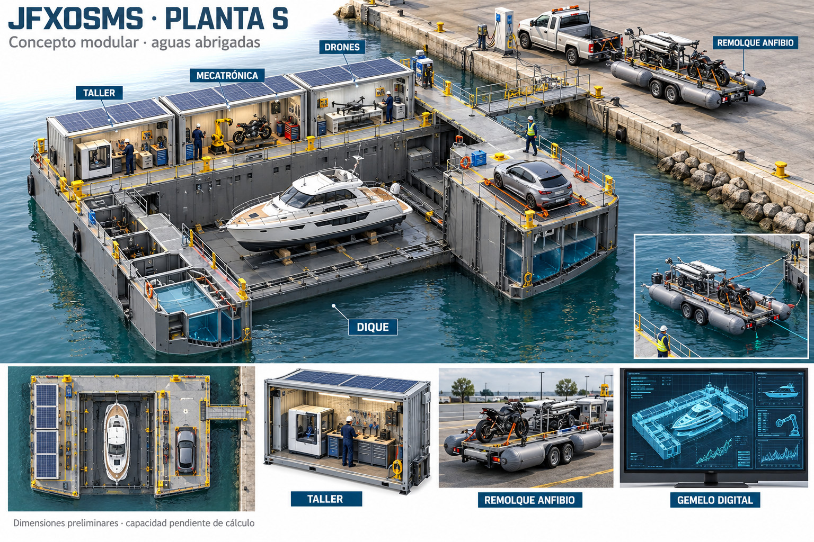

# JFXOSMS · Planta S: dique y microfábrica modular
Fecha: 12 de octubre de 2026. Primer concepto de una familia S → M → L. Esta entrega desarrolla S; M y las plantas de proyectos mayores se desarrollarán en las siguientes etapas solicitadas.

## Alcance y procedencia
Base: [JFXOSMS](https://github.com/robotics-intelligent-systems/jfxosms), [proceso modular](https://github.com/robotics-intelligent-systems/jfxosms/blob/main/docs/ai-modular-design-assembly-process.md), [concepto suplementario de planta flotante](https://github.com/robotics-intelligent-systems/jfxosms/pull/3) y [catálogo organizacional](https://github.com/robotics-intelligent-systems/.github/blob/main/profile/cad-catalog.json).
Diseño conceptual, sin cálculo naval, capacidad certificada, CAD de fabricación ni simulación física ejecutada. La imagen ilustra la distribución; sus proporciones y pequeños detalles no constituyen geometría de ingeniería.

## 1. Dimensiones iniciales y selección por producto
Las siguientes cifras son supuestos de este diseño, no dimensiones verificadas del catálogo.

| Parámetro | Valor conceptual S |
| --- | --- |
| Embarcación objetivo | Eslora hasta 12 m; manga hasta 4 m; calado a flote hasta 1,2 m |
| Planta en configuración base | 24 m de longitud × 16 m de anchura total |
| Pozo útil de dique | 18 m × 6 m, abierto por un extremo |
| Margen nominal con producto máximo centrado | 3 m en cada extremo; 1 m a cada costado |
| Segmentación longitudinal | Tres estaciones estructurales de 8 m |
| Configuración | Pontón de fondo continuo ensamblado + alas laterales compartimentadas |
| Talleres | Pods desmontables sobre una sola cubierta lateral |
| Uso inicial | Aguas abrigadas; amarre y alimentación desde muelle |

No se fija tonelaje admisible sin masa en rosca, peso del producto, cargas de taller y casos de estabilidad. Tampoco se fija calado del dique ni profundidad mínima de atraque. Para recibir un casco flotante: profundidad sobre apoyos sumergidos ≥ calado del producto + holgura bajo quilla; el punto más profundo del dique exige además margen sobre fondo. Incluir mareas, sedimentación, cabeceo, asiento y condición de lastre.

Para construir un casco desde cero: disponer primero del fondo seco y los apoyos verificados; colocar conjuntos por fases y comprobar estructura/estabilidad en cada fase. La recepción de un casco existente mediante inundación es otra secuencia de operación.

La elección de S/M/L depende de eslora, manga, calado, masa/CG, geometría de apoyos, altura, cargas puntuales, radios de manejo y margen operativo; no solo del calado. No ampliar S agregando módulos sin recalcular uniones, estructura y estabilidad.

## 2. Módulos y modos de operación
- **M01 · Dique:** fondo de apoyo, picaderos y alas; lastre segregado, medición de nivel, calado e inclinación. Uniones estructurales definidas y estancas según su localización.
- **M02 · Producción:** impresión polimérica/prototipado y preparación ligera. Metal aditivo y procesos con polvo o elevada energía necesitan módulos separados y estudio específico; no se incluyen como capacidad inicial.
- **M03 · Mecatrónica:** bancada reconfigurable, brazo modular, útiles de motocicleta/deportivo, cableado, integración y metrología.
- **M04 · Aeroespacial pequeño:** mesa limpia para drones, electrónica, ensamblaje de subconjuntos y ensayos de banco contenidos. No es pista de vuelo ni planta de aeronaves grandes.
- **M05 · Logística:** puente articulado, recepción de equipos, zona de transferencia y remolque anfibio opcional.
- **M06 · Gemelo digital y servicios:** estación local, registro de configuración, energía del muelle, almacenamiento eléctrico por dimensionar, generación solar complementaria.

Tres configuraciones alternativas sobre la misma base: **S-N naval**, con prioridad al pozo y montaje del casco; **S-M mecatrónica**, con módulos de taller y staging priorizados; **S-A drones**, con mayor superficie limpia y bancos. Compartir activos no implica operar todas las actividades al máximo simultáneamente. Prohibir transferencias móviles durante fases de lastre y maniobra del casco hasta disponer de análisis y procedimiento aprobado.

## 3. Vinculación con el catálogo
| Proyecto | Conceptos existentes | Aplicación en S |
| --- | --- | --- |
| jfxrtess | Motocicleta AM-B, deportivo AM-S, utilitario AM-U6 | Ensamblaje y bancos para motocicleta; deportivo sujeto a masa, tamaño y cargas de cubierta. AM-U6 requiere comprobación individual. |
| jfxai4mss | Catamarán solar anfibio, river cruiser | El catamarán es candidato solo si cabe en la envolvente S. River cruiser se reserva para estudio de clase mayor. |
| jfxotbs | Remolque GCS, VTOL de rescate, hangar | GCS y subconjuntos/electrónica; dimensiones del VTOL no establecidas, no se asigna aeronave completa a S. |
| jfxai4dia / jfxjts | eVTOL, girodino, giroplano, STOL, helicóptero | Bancos y subconjuntos compatibles; equipos completos requieren clasificación dimensional posterior. |
| jfxmbdss | USV, transporte anfibio, plataforma de efecto suelo, MOAB | USV solo si cabe; grandes plataformas y aeronaves quedan para las etapas mayores. |
| jfxai4mhers | Brazo modular y humanoide | Utillaje/celdas de ensamblaje y simulación de movimientos con alcance verificado. |

Los drones pequeños son una nueva carga de trabajo propuesta por el usuario; no se atribuyen a una ficha específica sin identificador confirmado. No se deducen dimensiones de las imágenes del catálogo.

## 4. Transferencia terrestre y anfibia
Ruta primaria: producto asegurado en cuna → remolque/camión adecuado → muelle → puente verificado → plataforma seca. Motocicletas y drones pueden compartir transporte si existen anclajes y separación adecuados.

Alternativa anfibia propuesta: remolque con flotadores laterales, ruedas, enganche, puntos de amarre y cuna; transferencia en agua abrigada con guía/cabrestante diseñado. No se presupone que el camión sea anfibio ni que un remolque flotante tenga propulsión o pueda remolcarse por carretera cargado con los flotadores desplegados.

El deportivo constituye otra configuración de carga. Verificar masa total, volumen sumergido, francobordo, CG, estabilidad transversal, reparto de cargas, resistencia de rampa y límites de ejes/enganche. La imagen muestra motocicleta y dron; no demuestra capacidad para un deportivo. Para cada carga: volumen desplazado = masa total / densidad del agua, con reserva de flotabilidad y estabilidad calculadas aparte.

## 5. SysML → simulación asistida por IA
Los Drawio existentes son documentación gráfica: leer sus formas no produce automáticamente un modelo SysML ejecutable. Primero reconstruir y revisar semántica: identificadores, bloques, puertos, relaciones, unidades, estados, restricciones y métodos de verificación. Para SysML v1, Papyrus/XMI es una alternativa; el dibujo editable adjunto es una vista de arquitectura y requisitos inspirada en SysML, no un modelo XMI ni SysML v2.

Flujo propuesto:
1. Diagramas/artefactos fuente → extracción asistida por IA de requisitos y relaciones, con vínculo a página y elemento.
2. Revisión humana → contrato versionado de parámetros y requisitos; errores o unidades ausentes bloquean ejecución.
3. Contrato → adaptadores explícitos a CAD, modelos de sistemas y simuladores. La IA propone; el adaptador determinista genera archivos y registra hashes/versiones.
4. Escenarios → barrido paramétrico, resultados, comparación con límites aprobados y vínculos «verify».
5. Revisión de ingeniería → modificación controlada de SysML/CAD. Los estados operativos reales requieren autoridad y controles independientes.

| Requisito inicial | Asignación | Verificación propuesta |
| --- | --- | --- |
| S-001 Envolvente y acceso | M01/M05 | Comprobación CAD de producto, apoyos y pasos; dimensiones según configuración. |
| S-002 Carga y estabilidad | M01 | Hidroestática y estados de lastre/carga; criterios navales por seleccionar. |
| S-003 Uniones y apoyos | M01 | FEM y pruebas de uniones con cargas aprobadas. |
| S-004 Calidad bajo movimiento | M02/M03/M04 | Simular movimiento, comparar con tolerancias del proceso y calibrar con medición. |
| S-005 Manipulación y transporte | M05 | CG, anclajes, rampas, flotabilidad y estabilidad para cada carga. |
| S-006 Control protegido | M01/M03 | Pérdida de alimentación/comunicación y respuesta definida; la IA no gobierna funciones de protección. |
| S-007 Trazabilidad digital | M06 | Cada resultado conserva requisito, modelo, unidades, versión, configuración y escenario. |
| S-008 Energía | M06 | Balance de cargas, respaldo y prioridades; no asumir autonomía solar. |

## 6. Alternativas de gemelo digital con software libre
**Alternativa A · puesta en marcha virtual:** Papyrus + FreeCAD + Gazebo + ROS 2. Prioriza distribución, cinemática de brazos, transferencias y movimiento de superficie. Modelos SDF/URDF requieren adaptadores y parámetros calibrados.

**Alternativa B · sistemas y energía:** Papyrus + FreeCAD + OpenModelica. Prioriza lastre, bombas, alimentación, baterías y estados de control; co-simulación mediante interfaces acordadas. Hidrodinámica necesita modelo adicional, no surge de un diagrama.

**Alternativa C · ingeniería estructural e hidrodinámica:** FreeCAD/FEM con CalculiX y modelos marinos especializados por seleccionar. Prioriza cargas, uniones y respuesta física; no sustituye la simulación de celdas.

A y B son rutas complementarias para el piloto; C profundiza la validación. Registro local de telemetría mediante MQTT y visualización opcional con Node-RED/Grafana, sujeto a versiones y licencias. Sin sensores y actualización validada, el primer entregable es un prototipo digital; el gemelo operativo requiere identidad física, calibración y sincronización.

Referencias primarias:
- [Papyrus y SysML](https://projects.eclipse.org/free-tags/sysml).
- [FreeCAD FEM](https://github.com/FreeCAD/FreeCAD-documentation/blob/main/wiki/FEM_Workbench.md).
- [Gazebo: vehículo de superficie](https://gazebosim.org/api/sim/10/surface_vehicles.html).
- [OpenModelica](https://openmodelica.org/).

## 7. Escenarios del primer piloto
Recepción de casco; construcción por etapas; elevación/achique; montaje de motocicleta; manipulación de deportivo; integración de dron; transferencia por rampa; remolque flotante; pérdida de energía; fallo de sensor; cambio de carga asimétrica. Evaluar configuración y límites antes de programar operación simultánea.

Esta entrega incluye imagen conceptual y vistas editables de requisitos/arquitectura. No se ejecutó el piloto ni se calcularon estabilidad, cargas, rendimiento o capacidad. Las clases M y L conservarán el contrato de requisitos, pero tendrán arquitectura y validación propias.

## 8. Requisitos verificables de alto nivel
La aprobación del concepto visual no es aceptación técnica. Todos los requisitos siguientes están **propuestos; evidencia pendiente**. Los valores geométricos son hipótesis de la configuración S, y los umbrales no definidos deben cerrarse antes de ensayar o operar.

| ID | Asignación | Requisito | Método | Criterio de aceptación propuesto | Responsable propuesto | Evidencia prevista |
| --- | --- | --- | --- | --- | --- | --- |
| S-001 | M01/M05 | SHALL verificar la envolvente del producto, apoyos y acceso en cada configuración. | CAD / inspección | Producto objetivo ≤ 12 × 4 m; pozo nominal 18 × 6 m; sin interferencias; márgenes finales aprobados. | Arquitectura naval | S-001-EV, pendiente |
| S-002 | M01 | SHALL definir y aprobar estados de carga, masa/CG, calados, francobordo y estabilidad. | Análisis naval | Cada estado cumple los criterios navales seleccionados; tonelaje, GM y límites pendientes de cálculo. | Arquitectura naval | S-002-EV, pendiente |
| S-003 | M01 | SHALL dimensionar fondo, alas, picaderos y uniones para cargas aprobadas. | FEM / ensayo | Tensiones, deformación y fatiga dentro de límites de material/norma seleccionados; límites pendientes. | Estructuras | S-003-EV, pendiente |
| S-004 | M02/M03/M04 | SHALL demostrar compatibilidad entre movimiento/vibración y tolerancias del proceso. | Simulación / ensayo | Resultados calibrados comparados con tolerancias aprobadas para cada equipo/proceso. | Manufactura | S-004-EV, pendiente |
| S-005 | M05 | SHALL aprobar rampas, anclajes, CG y flotabilidad para cada carga y ruta de transferencia. | Análisis / demostración | Capacidades, estabilidad y holguras aprobadas para carga real; deportivo no heredará calificación de moto. | Logística naval | S-005-EV, pendiente |
| S-006 | M01/M03 | SHALL conservar funciones de protección y autoridad local independientes de recomendaciones de IA. | Ensayo de fallos | Pérdida de enlace/energía y comando inválido cumplen respuesta aprobada; tiempos pendientes. | Control y seguridad | S-006-EV, pendiente |
| S-007 | M06 | SHALL vincular resultados a requisito, configuración, modelo, escenario, unidades y versiones. | Inspección / ensayo | 100% de resultados aceptados contiene identificadores y registro reproducible. | Ingeniería de sistemas | S-007-EV, pendiente |
| S-008 | M06 | SHALL aprobar balance energético y cargas esenciales para operación normal y degradada. | Análisis / ensayo | Fuentes/reserva cubren cargas y respuesta aprobadas; potencias y duración pendientes. | Energía | S-008-EV, pendiente |
| S-009 | M06 | SHALL revisar la semántica extraída de SysML/Drawio antes de generar entradas de simulación. | Inspección / ensayo | IDs únicos, unidades y campos obligatorios completos; modelos ambiguos o incompletos rechazados. | MBSE | S-009-EV, pendiente |
| S-010 | M01/M05 | SHALL separar construcción sobre apoyos secos de recepción de casco flotante. | Análisis / demostración | Cada maniobra tiene plan aprobado; profundidad sobre apoyos ≥ calado + holgura aprobada. | Operación naval | S-010-EV, pendiente |
| S-011 | M02/M03/M04 | SHALL separar procesos incompatibles y autorizar operación simultánea por configuración. | Inspección / análisis | Plano de zonas y secuencia aprobados; trabajos de riesgo y movimientos incompatibles bloqueados. | Manufactura y seguridad | S-011-EV, pendiente |
| S-012 | M06 | SHALL identificar activo y sensores, calidad/frescura de datos y calibración antes de declarar gemelo operativo. | Ensayo / inspección | Sensores y modelos trazables; datos obsoletos marcados; límites de frescura pendientes. | Gemelo digital | S-012-EV, pendiente |

## 9. Contratos de interfaz propuestos

| Interfaz | Datos/servicios | Regla de revisión |
| --- | --- | --- |
| I01 Producto ↔ dique | Geometría, masa, CG, apoyos, fase constructiva | Versionar carga y fase; no inferir propiedades de la imagen. |
| I02 Dique ↔ lastre/control | Nivel, válvulas, bombas, inclinación, calado, modos | Control local protegido; interbloqueos definidos antes de operación. |
| I03 Muelle/remolque ↔ logística | Rampa, carga, anclajes, posición y condiciones de transferencia | Comprobar capacidad en cada configuración; guía flotante requiere diseño propio. |
| I04 Taller ↔ servicios | Energía, comunicaciones, ventilación, carga sobre cubierta | Presupuesto y aislamiento por pod; acoples estructurales distintos de acoples de servicio. |
| I05 SysML ↔ adaptadores | IDs, bloques, puertos, unidades, relaciones, escenarios | Semántica revisada; generación determinista y reproducible. |
| I06 Sensores/simuladores ↔ gemelo | Tiempo, unidades, configuración, calidad, frescura y versiones | Separar datos medidos, simulados y sintéticos. |

## 10. Estados, evidencia y siguiente tarea
Estados propuestos: configuración → revisión de carga → preparación/lastre → recepción o construcción → achique/apoyo → trabajo autorizado → preparación de salida → salida. Estado de fallo: parar funciones afectadas y ejecutar respuesta local aprobada. Este esquema requiere un análisis de riesgos y detalle de interbloqueos antes de implementación.

**Siguiente tarea OSMS-S-PILOT-001:** crear una configuración nominal versionada, revisar el contrato de parámetros y ejecutar un escenario sintético identificado de acceso/transferencia. Después calibrar los modelos navales y de movimiento con fuentes o mediciones adecuadas. Un resultado sintético no valida capacidad de elevación ni seguridad naval.

**MADUREZ:** arquitectura/documentación (~20%, estimación editorial). No hay simulación física ejecutada ni capacidad validada. M y L son etapas futuras y no heredan la verificación de S.

## Artefactos del diseño

- [CAD conceptual](../../MBSE/CAD/jfxosms-small-modular-floating-dock-digital-twin-concept-v1.jpg).
- [Seis vistas editables de requisitos, bloques, interfaces, restricciones, estados y verificación](../../MBSE/CAS/Drawio/JFXOSMS_Small_Floating_Dock_High_Level_Requirements.drawio).
- [Índice del proyecto](../README.md).

Drawio contiene vistas de ingeniería inspiradas en SysML; no es un modelo XMI ejecutable ni una exportación SysML v2.
