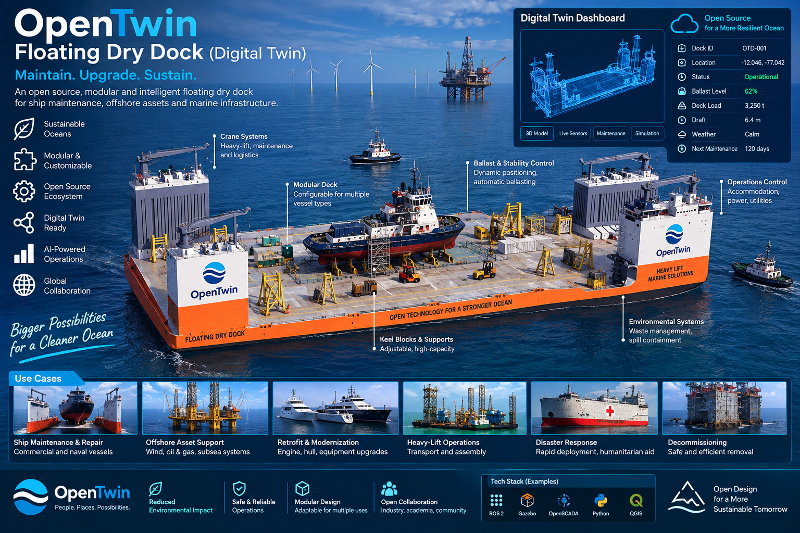
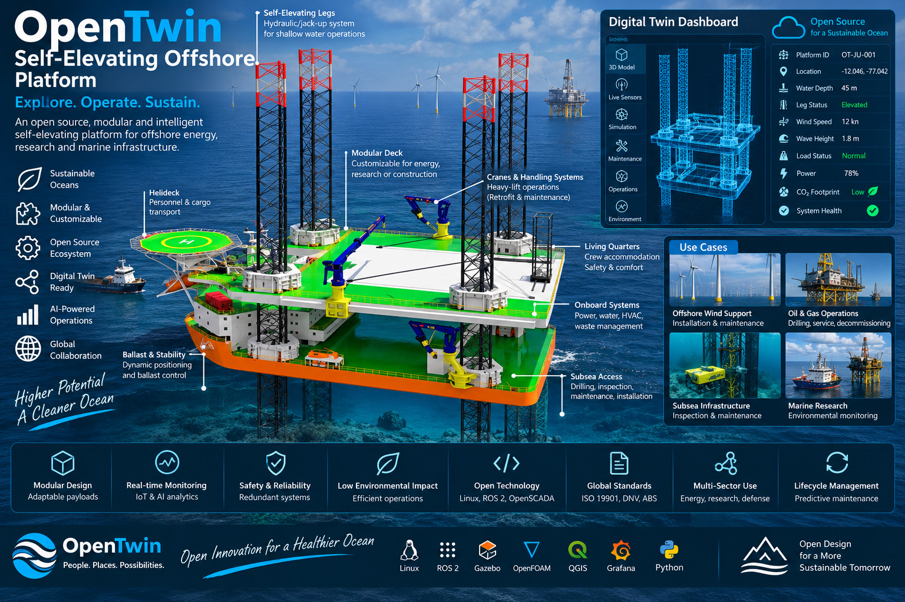

# Transferred offshore infrastructure concepts

**Revision:** 12 October 2026. **Status:** visual concepts; engineering, simulation and operating evidence pending.

JFXOSMS owns these two infrastructure illustrations and their proposed manufacturing/simulation studies. They complement [Plant S requirements](requirements/small-floating-dock-high-level-specification.md) and the [modular manufacturing process](ai-modular-design-assembly-process.md), but have no verified size class, lifting capacity or compatible-vessel envelope. They are not automatically the medium/large variants of Plant S.

### Floating Dry Dock

The concept combines a modular dock deck, side structures, cranes, keel blocks and supports, ballast systems, utilities and an operations station. Its proposed twin would represent dock configuration, supported vessel geometry, ballast state, maintenance tasks, lifting resources and environmental observations.

For JFXOSMS, the dock is an infrastructure concept for vessel construction/repair, modular production and equipment integration. JFXAI4MOMS may reference it for mining-equipment maintenance without owning its CAD asset. Candidate simulations include resource scheduling, load distribution, ballast changes, maintenance downtime and waste/spill handling. The illustration's deck load, draft, ballast percentage and “Operational” status are not measured or approved limits. Structural capacity, stability, vessel compatibility and operating procedures require independent engineering evidence.

### Self-Elevating Offshore Platform

The platform depicts a modular deck supported by jack-up legs, handling cranes, a helideck, accommodation, utilities and subsea access. Its twin would track leg/deck configuration, equipment readiness, crane tasks, utility demand and local environmental conditions.

The proposed role is site-specific coastal or shallow-water survey, maintenance and infrastructure support. This is **not a deep-ocean seabed support foundation**: water depth, seabed bearing conditions, leg loads, weather and installation method must be established for a particular site. The ocean-mining vehicle may operate in a separate location; the illustration does not establish that the jack-up platform can support an abyssal mission.

Hydrodynamic, structural, geotechnical and handling studies remain necessary. Standards and classification names printed in the image are references, not evidence of conformity or certification.

## Project boundaries and proposed simulation

JFXOSMS owns dock/platform configuration, structure, utilities, production/assembly interfaces and infrastructure simulation. JFXAI4MOMS owns mining/geology, mission and sample data, environmental interpretation and fleet workflows. Any integration exchanges explicit asset IDs, configuration versions, units, reference frames, time, quality and logistics-task records.

Candidate free-software studies: FreeCAD for geometry; Gazebo/ROS 2 for handling and robot interactions; OpenModelica for ballast/utility systems; specialized structural, hydrodynamic and geotechnical models for separate load cases. Each adapter and version requires review. No simulations were executed during this transfer.

The floating dock needs hydrostatics, ballast, supported-vessel loading and stability evidence. The jack-up needs site-specific water depth, leg loads, jacking mechanism and seabed bearing evidence; its elevated operating mode differs from its floating transport mode. Neither the helideck nor the cranes depicted establish approved operating capacity.

## Provenance and migration register

The JPG bytes and filenames are preserved. Ownership relocation does not change the artwork or validate the claims printed in it.

| File | Original Git blob | Immutable source |
| --- | --- | --- |
| `floating-dry-dock-concept.jpg` | `9b68024b9c5965905ac12d53e170ee4e4cdc1db1` | [Original](https://github.com/robotics-intelligent-systems/jfxai4moms/blob/f972d54ae53b98f68cd593bfdf37730c96c5cff5/MBSE/CAD/floating-dry-dock-concept.jpg) |
| `offshore-platform-concept.jpg` | `b43590691d505f94f4f435c74ca21e20e24cf93f` | [Original](https://github.com/robotics-intelligent-systems/jfxai4moms/blob/f972d54ae53b98f68cd593bfdf37730c96c5cff5/MBSE/CAD/offshore-platform-concept.jpg) |

Source baseline: `f972d54ae53b98f68cd593bfdf37730c96c5cff5`. The original remains in JFXAI4MOMS Git history; current gallery/catalog entries point to JFXOSMS. The Ocean Mining vehicle stays in JFXAI4MOMS. This transfer is documentation and asset organization, not a runtime integration or physical relocation.

## Main-branch publication correction

The earlier offshore transfer PR #6 was merged into the first review branch after PR #5 had already been merged to main. This correction publishes the unchanged offshore JPG and its documentation directly to main through a new PR. Git blob `b43590691d505f94f4f435c74ca21e20e24cf93f` identifies the original content; no image optimization or design regeneration is performed.
